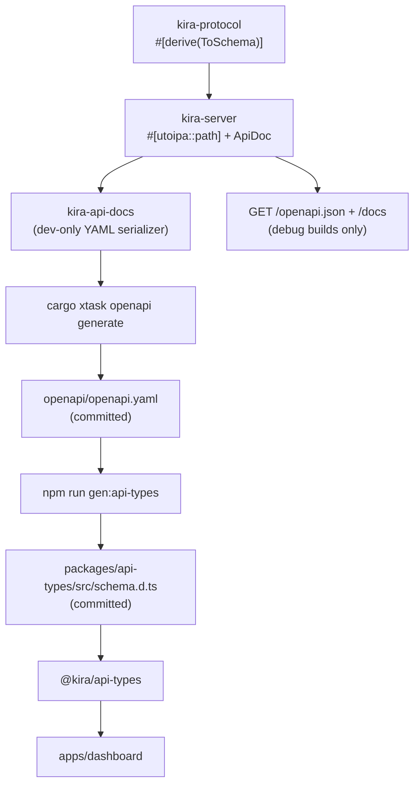

# Kira API and contract

`kira` exposes the HTTP and WebSocket API documented in OpenAPI. The browser
talks to it directly; `kira-cli` only serves dashboard assets. See
[CONFIGURATION.md](CONFIGURATION.md) for the environment variables referenced
here and [ARCHITECTURE.md](ARCHITECTURE.md) for crate placement.

## HTTP and WebSocket surface

| Method | Path | Auth | Behavior |
|---|---|---|---|
| `GET` | `/health` | public | `200 application/json` with `{ "status": "ok", "version": "0.1.0" }` |
| `POST` | `/auth/login` | public | `204` + session cookie; `400`/`415`/`422` malformed body; `401` wrong PIN; `403` bad origin; `429` rate limited (`Retry-After`) |
| `POST` | `/auth/logout` | public | `204` + clearing cookie |
| `GET` | `/auth/session` | cookie | `204` with a valid session, `401` otherwise |
| `GET` | `/guild` | cookie | `200` with the `KIRA_GUILD_ID` server's details, or `503` while unavailable |
| `GET` | `/guild/channels` | cookie | `200` with the configured server's channels, or `503` while unavailable |
| `POST` | `/guild/channels/{channel_id}/messages` | cookie | `201` with the sent `SentMessage`; `400`, `401`, `404`, `502`, `503`, or `504` on failure |
| `GET` | `/ws` | cookie + origin | WebSocket echo scaffold |
| `GET` | `/docs` | public | Scalar API Reference UI (debug builds only) |
| `GET` | `/openapi.json` | public | Live OpenAPI document from `ApiDoc` (debug builds only) |

The handlers and `#[utoipa::path]` annotations live in `kira-server`. The API
reference routes are mounted only under `debug_assertions`; release builds
return `404` for both paths.

`GET /guild` returns `503` until the bot has cached the server named by
`KIRA_GUILD_ID`. `KIRA_GUILD_ID` is required and a missing value fails at
startup. `GET /guild/channels` follows the same availability rule and returns
the cached channels of that server.

`POST /guild/channels/{channel_id}/messages` validates the channel against that
cached list and rejects channel kinds that cannot receive messages with `400`.
It then forwards the raw Discord message JSON to the bot over an in-process
channel. The bot posts the payload unchanged and returns the Discord message
ID; the request fails with `504` if the bot does not answer within 15 seconds.

`GET /ws` requires a valid session cookie and an allowed `Origin` when one is
sent. Text and binary frames are echoed; ping/pong are handled by Axum; close
ends the socket. WebSockets are not representable in OpenAPI and are
intentionally undocumented.

## Authentication

The server is stateless: it keeps no session store and supports no revocation.

- The PIN comes from `KIRA_PASSWORD`. When unset or empty, the server generates
  a random six-digit PIN at startup and logs it once at `warn`.
- `POST /auth/login` takes `{ "pin": "..." }`. On success it sets
  `kira_session=<token>` and returns `204` with no body.
- The token is `<version>.<exp>.<HMAC-SHA256>`, signed with a 32-byte key
  generated at startup. It expires 12 hours after issue. A restart invalidates
  every outstanding token.
- `POST /auth/logout` only clears the cookie client-side.
- Protected API routes and `/ws` validate the token signature and expiry on
  every request. A missing, malformed, tampered, or expired cookie yields
  `401`.
- The cookie is `HttpOnly; Path=/; Max-Age=43200` plus `SameSite=Lax` by
  default. `KIRA_COOKIE_SECURE` adds `Secure`; `KIRA_COOKIE_SAMESITE` accepts
  `lax`, `strict`, or `none` (`none` requires `secure`). The PIN, signing key,
  and token are never exposed in response bodies or to JavaScript.
- Login attempts are limited to 5 failures per peer IP per 15 minutes and 50
  failures globally per 15 minutes, returning `429` with `Retry-After`. The
  peer address comes from the TCP connection; `X-Forwarded-For` and
  `Forwarded` are ignored.

### Origins and CORS

`KIRA_ALLOWED_ORIGINS` is a comma-separated list of exact `scheme://host[:port]`
origins. A loopback deployment derives defaults from the dashboard bind
(`KIRA_CLI_BIND`, both `127.0.0.1` and `localhost`) plus the Vite dev server on
port `5173`. Set the list explicitly when the dashboard binds beyond loopback,
uses another hostname, or the browser reaches it through a different origin. A
non-loopback `KIRA_BIND` is refused at startup unless `KIRA_HTTPS=true`,
`KIRA_COOKIE_SECURE=true`, and the list is set.

Allowed origins receive credentialed CORS headers. Requests carrying an
`Origin` that is not allowlisted are rejected with `403`, including the login,
message, and WebSocket routes. Requests without an `Origin` (curl, tests) are
allowed. Cookies are scoped by host, so `localhost` and `127.0.0.1` cannot be
mixed in one session.

## OpenAPI and TypeScript contract



### Ownership

- Route annotations live in `kira-server`.
- Request/response schemas live with the DTOs in `kira-protocol`.
- `kira-server` assembles the full `OpenApi` document (`ApiDoc`) from its route
  annotations and serves it only in debug builds. The session cookie is
  declared as the `cookie_auth` API key security scheme.
- `kira-api-docs` serializes that document to YAML for the committed contract.
  It depends on `kira-server`, never the reverse.
- `xtask` is the only consumer of `kira-api-docs`.

### Commands

```bash
cargo xtask openapi generate   # write openapi/openapi.yaml
cargo xtask openapi check      # regenerate in memory; fail on drift
npm run gen:api-types          # regenerate packages/api-types/src/schema.d.ts
npm run check:api-types        # fail if the committed schema is stale
make openapi                   # both generation steps
```

`generate` writes exactly one trailing newline and is deterministic. `check`
never writes; it compares bytes and prints the file path plus the regeneration
command on drift. `make check` runs both Rust and TypeScript drift checks, so a
route change cannot silently leave either contract stale.

### Adding an HTTP endpoint

1. Add or extend the DTO in `kira-protocol`, deriving `Serialize`,
   `Deserialize`, and `ToSchema`.
2. Add a handler in `kira-server` with `#[utoipa::path]`, mount it in
   `router()`, and decide whether it belongs behind the session middleware.
3. Run `make openapi` to update the YAML and TypeScript schema.
4. Use the generated type in the dashboard via `@kira/api-types`.
5. Run `make check`.
