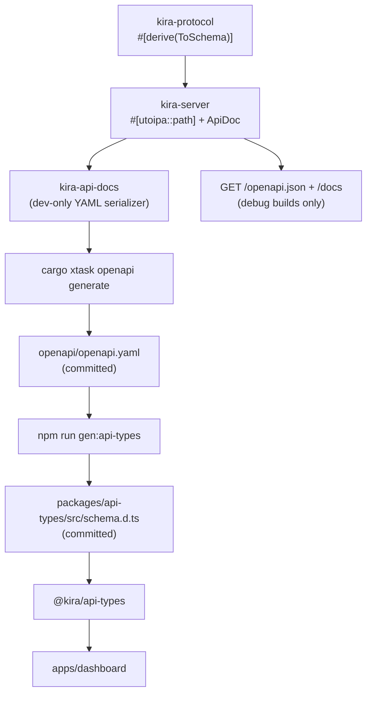

# Kira API and contract

Two routers exist: the remote `kira` server (documented in OpenAPI) and the
local `kira-cli` BFF that proxies it for the dashboard. See
[CONFIGURATION.md](CONFIGURATION.md) for the environment variables referenced
here and [ARCHITECTURE.md](ARCHITECTURE.md) for crate placement.

## HTTP and WebSocket surface

### `kira` server (documented in OpenAPI)

| Method | Path | Behavior |
|---|---|---|
| `GET` | `/health` | `200 application/json` with `{ "status": "ok", "version": "0.1.0" }` |
| `GET` | `/guild` | `200` with the `KIRA_GUILD_ID` server's details, or `503` while unavailable |
| `GET` | `/guild/channels` | `200` with the configured server's channels, or `503` while unavailable |
| `POST` | `/guild/channels/{channel_id}/messages` | `201` with the sent `SentMessage`; `400`, `401`, `404`, `502`, `503`, or `504` on failure |
| `GET` | `/docs` | Scalar API Reference UI (debug builds only) |
| `GET` | `/openapi.json` | Live OpenAPI document from `ApiDoc` (debug builds only) |

The handler is defined at the `kira-server` crate root and annotated with
`#[utoipa::path]`. OpenAPI covers the remote server only.

The API reference routes are mounted only under `debug_assertions`; release
builds return `404` for both paths.

`GET /guild` returns `503` until the bot has cached the server named by
`KIRA_GUILD_ID`. `KIRA_GUILD_ID` is required and a missing value fails at
startup. `GET /guild/channels` follows the same availability rule and returns
the cached channels of that server.

When `KIRA_API_TOKEN` is set, `/guild`, `/guild/channels`, and the message
endpoint require `Authorization: Bearer <token>` and return `401` otherwise.
`/health` stays public. A non-loopback `KIRA_BIND` is refused unless a token is
configured.

`POST /guild/channels/{channel_id}/messages` validates the channel against that
cached list and rejects channel kinds that cannot receive messages with `400`.
It then forwards the raw Discord message JSON to the bot over an in-process
channel. The bot posts the payload unchanged and returns the Discord message
ID; the request fails with `504` if the bot does not answer within 15 seconds.

`GET /ws` is a WebSocket echo scaffold. Text and binary frames are echoed;
ping/pong are handled by Axum; close ends the socket. WebSockets are not
representable in OpenAPI and are intentionally undocumented.

### `kira-cli` local routes (internal BFF, not in OpenAPI)

| Method | Path | Behavior |
|---|---|---|
| `GET` | `/api/health` | Proxy to remote `/health`; `502` JSON on failure |
| `GET` | `/api/guild` | Proxy to remote `/guild`; passes through `503`, `502` on failure |
| `GET` | `/api/guild/channels` | Proxy to remote `/guild/channels`; passes through `503`, `502` on failure |
| `POST` | `/api/guild/channels/{channel_id}/messages` | Proxy to remote messages endpoint; passes through success and error statuses, `502` when unreachable |
| `GET` | `/ws` | Frame-by-frame proxy to remote `/ws` |
| `GET` | `/` and other non-API paths | Vite dev server in debug; embedded `index.html` (SPA fallback) in release |
| `GET` | `/assets/*` | Vite dev server in debug; embedded asset or `404` in release |
| any | `/api/*` miss | `404`, never the SPA fallback |

In release, static responses set `Content-Type` from the file extension. Hashed
`/assets/*` responses use `Cache-Control: public, max-age=31536000, immutable`;
the SPA shell uses `no-cache`. Embedded lookups use exact relative paths, and
asset paths containing `.` or `..` segments are rejected. Debug builds forward
non-API requests to Vite instead of serving embedded files.

## OpenAPI and TypeScript contract



### Ownership

- Route annotations live in `kira-server`.
- Request/response schemas live with the DTOs in `kira-protocol`.
- `kira-server` assembles the full `OpenApi` document (`ApiDoc`) from its route
  annotations and serves it only in debug builds.
- `kira-api-docs` serializes that document to YAML for the committed contract.
  It depends on `kira-server`, never the reverse.
- `xtask` is the only consumer of `kira-api-docs`.

### Commands

```bash
cargo xtask openapi generate   # write openapi/openapi.yaml
cargo xtask openapi check      # regenerate in memory; fail on drift
npm run gen:api-types          # regenerate packages/api-types/src/schema.d.ts
npm run check:api-types        # fail if the committed schema is stale
make openapi                   # both generation steps
```

`generate` writes exactly one trailing newline and is deterministic. `check`
never writes; it compares bytes and prints the file path plus the regeneration
command on drift. `make check` runs both Rust and TypeScript drift checks, so a
route change cannot silently leave either contract stale.

### Adding an HTTP endpoint

1. Add or extend the DTO in `kira-protocol`, deriving `Serialize`,
   `Deserialize`, and `ToSchema`.
2. Add a handler in `kira-server` with `#[utoipa::path]` and mount it in
   `router()`.
3. Run `make openapi` to update the YAML and TypeScript schema.
4. Use the generated type in the dashboard via `@kira/api-types`.
5. Run `make check`.
