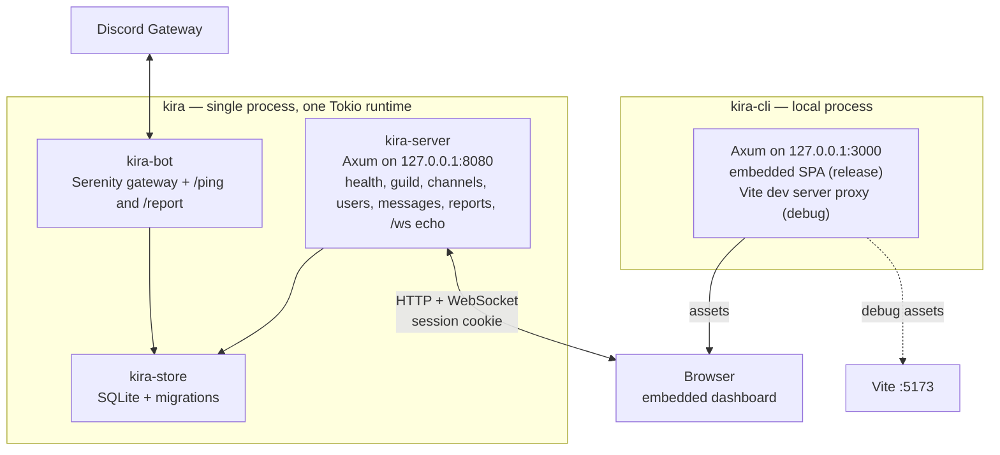
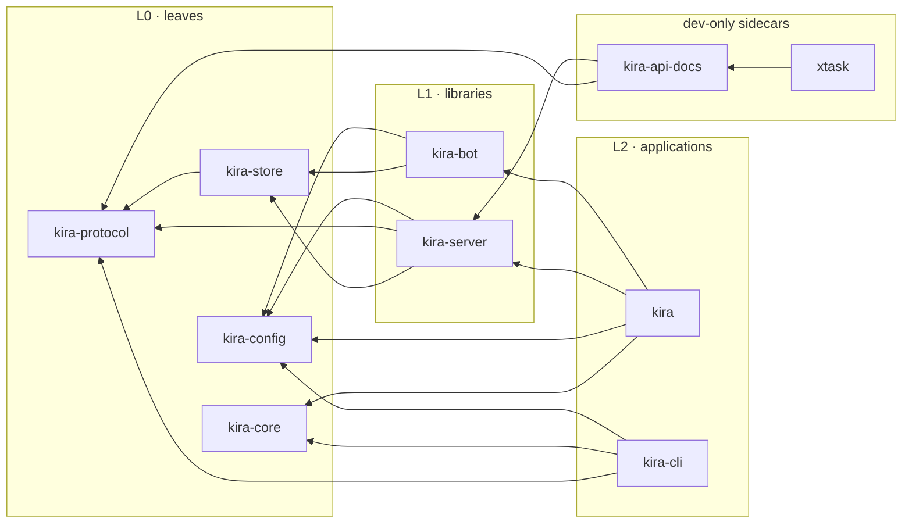

# Kira architecture

Kira is a Rust monorepo with two application binaries:

- **`kira`** — the main service. It runs the Discord bot and the HTTP/WebSocket
  API in one process.
- **`kira-cli`** — a local application. It serves the built Vite dashboard and
  proxies API/WebSocket traffic to a remote `kira` server.

A shared OpenAPI document is generated from the Rust route annotations, committed,
and used to generate the TypeScript types consumed by the dashboard. See
[API.md](API.md) for the routes and the contract workflow.

Smaller documents split out of this guide:

- [API.md](API.md) — HTTP/WebSocket surface and OpenAPI ownership.
- [CONFIGURATION.md](CONFIGURATION.md) — environment variables.
- [DASHBOARD.md](DASHBOARD.md) — React app, data layer, build and embedding.
- [DEVELOPMENT.md](DEVELOPMENT.md) — make targets, gate, build matrix.

## 1. System at a glance



Ports are configurable; the defaults above are what the Makefile and Vite dev
proxy assume. The browser talks to `kira` directly for API and WebSocket
traffic; `kira-cli` only serves assets.

## 2. Repository layout

```
kira/
├── Cargo.toml                    Cargo workspace (virtual manifest)
├── Cargo.lock                    committed; the two binaries are applications
├── .cargo/config.toml            `cargo xtask` alias
├── Makefile                      build, dashboard, OpenAPI, check workflow, dev runner
├── package.json                  npm workspace root
├── package-lock.json             committed for reproducible installs
├── openapi/
│   └── openapi.yaml              generated + committed API contract
├── migrations/
│   └── *.up.sql / *.down.sql     SQLx migrations applied at startup
├── crates/
│   ├── kira/                     binary: bot + server composition
│   ├── kira-cli/                 binary: local dashboard host (embedded SPA)
│   ├── kira-core/                shared runtime utilities (logging, messaging, shutdown)
│   ├── kira-config/              environment configuration
│   ├── kira-protocol/            shared HTTP/WS DTOs
│   ├── kira-store/               SQLite storage, repositories, migrations
│   ├── kira-bot/                 Serenity client, event handler, slash commands
│   ├── kira-server/              Axum router, auth, handlers, utoipa annotations
│   └── kira-api-docs/            OpenAPI YAML serialization (dev-only)
├── xtask/                        OpenAPI generate/check tooling
├── apps/
│   └── dashboard/                Vite + React + TypeScript dashboard
├── packages/
│   └── api-types/                generated TypeScript API types
├── scripts/
│   └── smoke-test.sh             release binary sanity check
└── docs/                         architecture, API, configuration, dashboard, development
```

`crates/*` and `xtask` are Cargo workspace members. `apps/*` and `packages/*` are
npm workspaces and are excluded from Cargo.

## 3. Crate graph and boundaries



Rules:

1. Leaf crates never depend upward.
2. `kira-bot` and `kira-server` never depend on each other.
3. `kira` and `kira-cli` never depend on `kira-api-docs` or `xtask`.
4. `kira-api-docs` is a capstone over `kira-server`; it is never a dependency of
   an application. This keeps OpenAPI YAML serialization out of production
   binaries. The document itself is assembled in `kira-server` so debug builds
   can serve it live.
5. `xtask` is never a dependency of any shipped crate.

`make check` enforces the most important boundaries with `cargo tree`
assertions.

### Error handling boundaries

- **Applications** (`kira`, `kira-cli`, `xtask`) use `anyhow::Result` and add
  context at each operational boundary: configuration, binding, serving, and
  the bot/server join.
- **Reusable crates** expose typed `thiserror` errors: `ConfigError`,
  `BotError`, `ServerError`, and `ApiDocsError`.
- Authentication failures are typed separately: `LoginError` distinguishes a
  wrong PIN from a rate-limited caller, and `ServerError` covers configuration
  and startup failures such as an invalid origin allowlist.

## 4. Runtime architecture

### 4.1 `kira`

`kira` loads configuration, starts the bot, optionally starts the HTTP server,
and waits for Ctrl-C/SIGTERM.

- `kira-core::logging::init()` installs the `tracing` subscriber before any
  work; `RUST_LOG` controls the filter (default `info`) and logs go to stderr.
- `kira-config::DiscordConfig` requires `DISCORD_TOKEN`.
- `kira-config::ServerConfig` requires `KIRA_GUILD_ID` and supplies `KIRA_BIND`
  (default `127.0.0.1:8080`), `KIRA_PASSWORD`, `KIRA_ALLOWED_ORIGINS`,
  `KIRA_HTTPS`, `KIRA_COOKIE_SECURE`, `KIRA_COOKIE_SAMESITE`, and the dashboard
  bind used to derive default origins (`KIRA_CLI_BIND`).
- `kira-config::DatabaseConfig` supplies `KIRA_DATABASE_URL` (default
  `sqlite:kira.db`).
- `kira-store::Database::connect` opens the SQLite database and runs the SQLx
  migrations in `migrations/`. It owns the connection pool; `reports()` and
  `users()` expose independent repositories over that pool.
- `kira-bot::run` builds the Serenity client with the
  `GUILD_MESSAGES | DIRECT_MESSAGES | MESSAGE_CONTENT` intents, registers the
  config in Serenity's type map, and starts the gateway. It caches only the
  configured guild. `/report` opens a modal and saves the submission to the
  report repository.
- Guild membership is event-driven: member additions and removals write the
  user state and a join/leave event in one transaction. A background worker
  refreshes active users' names in batches on a three-day per-user cooldown and
  never changes membership status. Member events require the `GUILD_MEMBERS`
  privileged intent to be enabled for the bot in the Discord developer portal.
- `kira-server::serve` binds the configured address and runs Axum with graceful
  shutdown.
- A `tokio::sync::watch` channel fans a single shutdown signal out to both
  components. On a signal, the server stops accepting connections and the bot
  calls `shard_manager.shutdown_all()`.
- The bot handles the startup edge case where no shards have been instantiated:
  `shutdown_all()` is a no-op in that state, so the gateway future is not
  awaited and is cancelled instead of booting forever.

#### Cargo features

```toml
[features]
default = ["server"]
server = ["dep:kira-server"]
```

| Build | Result |
|---|---|
| `cargo build -p kira` | Bot + HTTP/WebSocket server (default) |
| `cargo build -p kira --no-default-features` | Bot only; no Axum or `kira-server` in the tree |

`--version` and `--help` are handled before configuration loading, so the smoke
test cannot accidentally start the gateway.

### 4.2 `kira-cli`

`kira-cli` is a local static host for the built dashboard.

- `kira-config::CliConfig` reads `KIRA_CLI_BIND` (default `127.0.0.1:3000`).
- The local Axum router only has a fallback:
  - Release builds serve the embedded dashboard with SPA fallback and asset
    caching.
  - Debug builds proxy non-API requests to Vite on `127.0.0.1:5173`, so
    frontend changes are visible without a Rust rebuild. This uses the default
    `dev-proxy` feature.
- Release builds pass `--no-default-features` (as `make build-cli` does) to
  omit the Vite proxy, `reqwest`, and `kira-protocol`; the shipped binary only
  serves embedded assets.
- `/api/*` paths always return `404`; `kira-cli` never forwards API or
  WebSocket traffic.
- The process shuts down gracefully on Ctrl-C/SIGTERM.

See [API.md](API.md) for the server route tables and [DASHBOARD.md](DASHBOARD.md)
for the frontend.

## 5. Design decisions and rationale

- **One Cargo workspace.** One lockfile, one set of dependency versions, and
  per-package builds. Multiple workspaces would duplicate tooling and versions.
- **`kira-api-docs` as a capstone.** Putting the `OpenApi` derive in
  `kira-server` would pull document assembly and YAML serialization into
  production binaries. Depending the other way keeps production lean while
  still deriving the contract from live route annotations.
- **`server` feature on `kira`.** The main binary can be built bot-only without
  dragging Axum into the dependency tree.
- **`rust-embed` for the dashboard.** Release binaries are self-contained;
  debug builds keep frontend iteration fast.
- **npm workspaces + committed lockfile.** Two frontend packages do not justify
  an extra package-manager tool, and the lockfile makes generation reproducible.
- **`openapi-typescript`.** The named `typescript-openapi` package does not
  exist; `openapi-typescript` consumes the committed YAML and emits `.d.ts`
  with no runtime dependency.
- **Exact embedded lookups.** Serving from the embedded file set instead of
  joining a filesystem root makes path traversal impossible.
- **`anyhow` at the edges, `thiserror` in libraries.** Binaries own
  operational context; reusable crates keep typed errors so callers can react
  to failure modes without parsing strings.
- **Typed dashboard data layer.** `openapi-fetch` consumes the generated
  `paths`, TanStack Query owns server state, and domain folders keep keys,
  queries, and mutations together.
- **File-based routing.** `@tanstack/router-plugin` generates the route tree
  from `src/routes`; the generated tree is committed so `tsc` works before
  Vite runs.
- **`tracing` for logs.** One subscriber installed by `kira_core::logging`,
  macros in libraries, and `RUST_LOG` for filtering.

## 6. Current scope and limitations

Implemented:

- Workspace, crate boundaries, and feature topology.
- Discord `!ping` → `Pong!`.
- Discord `/ping` slash command → `pong` (registered per guild, or globally in
  bot-only builds).
- `GET /health`, guild/channel reads, and guild message posting.
- Local dashboard hosting, SPA fallback, asset caching, HTTP/WS proxying.
- Dashboard navigation, health, guild header, theme toggle, and announcements.
- OpenAPI generation and TypeScript contract checks.
- Build, lint, test, and smoke-test workflow.

Not implemented yet:

- Authentication beyond the shared API token, persistence, or broader domain
  models.
- A WebSocket protocol beyond the echo/bridge scaffold.
- TLS acceptance testing. The client features support `https`/`wss`, but tests
  are localhost HTTP/WS only.

See [DEVELOPMENT.md](DEVELOPMENT.md) for commands.
