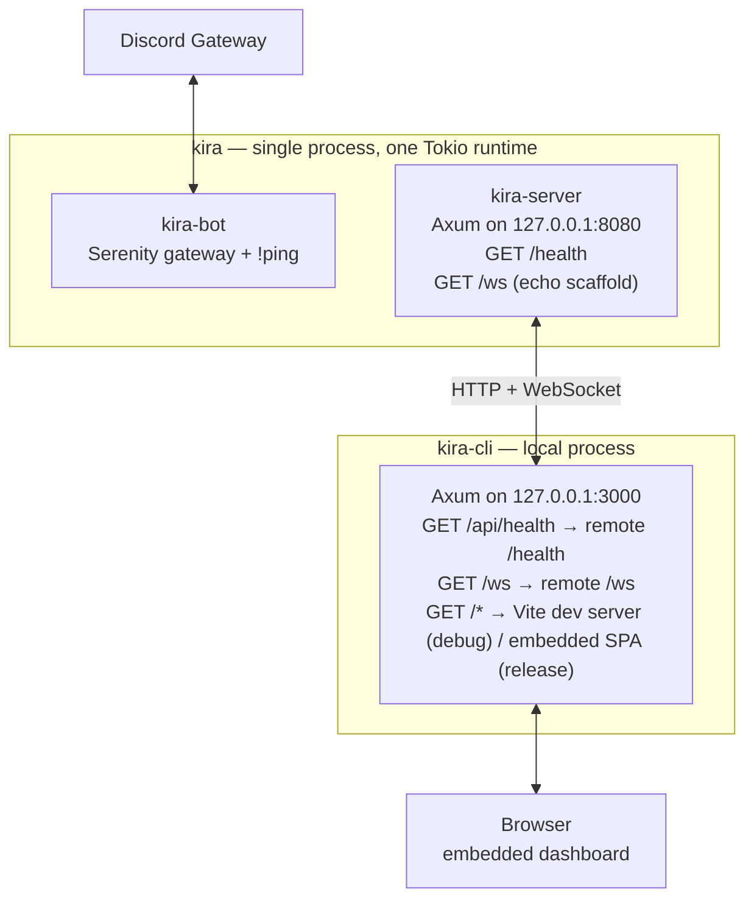
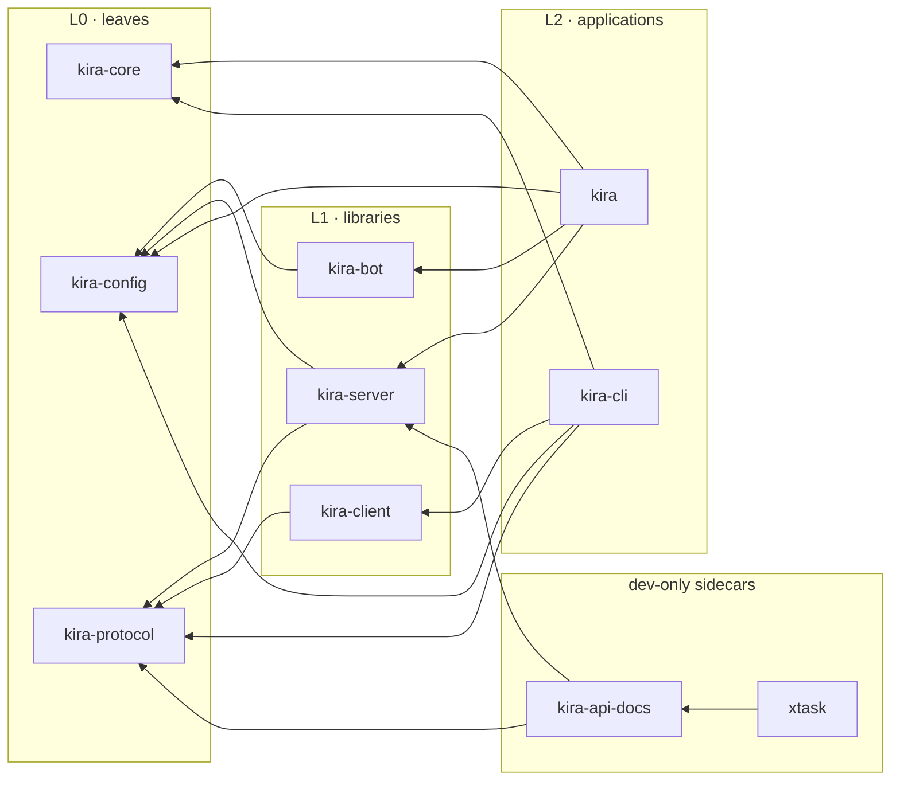
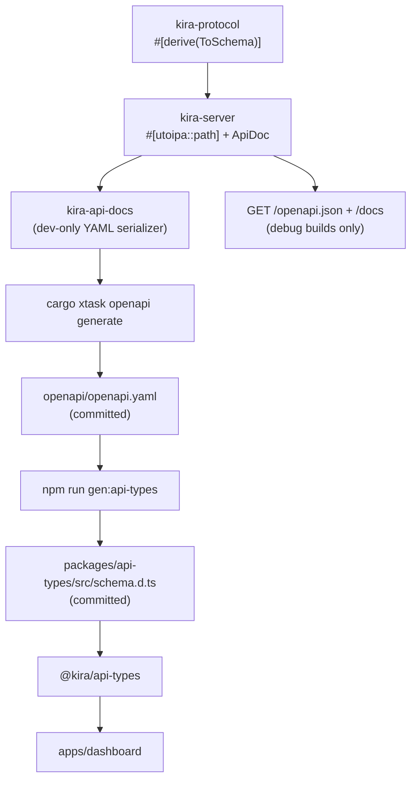

# Kira Architecture and Workflow

Kira is a Rust monorepo with two application binaries:

- **`kira`** — the main service. It runs the Discord bot and the HTTP/WebSocket
  API in one process.
- **`kira-cli`** — a local application. It serves the built Vite dashboard and
  proxies API/WebSocket traffic to a remote `kira` server.

A shared OpenAPI document is generated from the Rust route annotations, committed,
and used to generate the TypeScript types consumed by the dashboard.

## 1. System at a glance



Ports are configurable; the defaults above are what the Makefile and Vite dev
proxy assume.

## 2. Repository layout

```
kira/
├── Cargo.toml                    Cargo workspace (virtual manifest)
├── Cargo.lock                    committed; the two binaries are applications
├── .cargo/config.toml            `cargo xtask` alias
├── Makefile                      build, dashboard, OpenAPI, check workflow, dev runner
├── package.json                  npm workspace root
├── package-lock.json             committed for reproducible installs
├── openapi/
│   └── openapi.yaml              generated + committed API contract
├── crates/
│   ├── kira/                     binary: bot + server composition
│   ├── kira-cli/                 binary: local dashboard host + proxy
│   ├── kira-core/                signal handling
│   ├── kira-config/              environment configuration
│   ├── kira-protocol/            shared HTTP/WS DTOs
│   ├── kira-bot/                 Serenity client and event handler
│   ├── kira-server/              Axum router, handlers, utoipa annotations
│   ├── kira-client/              HTTP + WebSocket client
│   └── kira-api-docs/            OpenAPI YAML serialization (dev-only)
├── xtask/                        OpenAPI generate/check tooling
├── apps/
│   └── dashboard/                Vite + React + TypeScript dashboard
├── packages/
│   └── api-types/                generated TypeScript API types
├── scripts/
│   └── smoke-test.sh             release binary sanity check
└── docs/                         design, plan, and this architecture guide
```

`crates/*` and `xtask` are Cargo workspace members. `apps/*` and `packages/*` are
npm workspaces and are excluded from Cargo.

## 3. Crate graph and boundaries



Rules:

1. Leaf crates never depend upward.
2. `kira-bot` and `kira-server` never depend on each other.
3. `kira-client` never depends on the bot or server.
4. `kira` and `kira-cli` never depend on `kira-api-docs` or `xtask`.
5. `kira-api-docs` is a capstone over `kira-server`; it is never a dependency of
   an application. This keeps OpenAPI YAML serialization out of production
   binaries. The document itself is assembled in `kira-server` so debug builds
   can serve it live.
6. `xtask` is never a dependency of any shipped crate.

`make check` enforces the most important boundaries with `cargo tree`
assertions.

### Error handling boundaries

- **Applications** (`kira`, `kira-cli`, `xtask`) use `anyhow::Result` and add
  context at each operational boundary: configuration, binding, serving, and
  the bot/server join.
- **Reusable crates** expose typed `thiserror` errors: `ConfigError`,
  `BotError`, `ServerError`, `ClientError`, and `ApiDocsError`.
- The CLI's HTTP proxy logs upstream failures locally and returns a generic
  `502` JSON body. Upstream error details do not cross the HTTP boundary.

## 4. Runtime architecture

### 4.1 `kira`

`kira` loads configuration, starts the bot, optionally starts the HTTP server,
and waits for Ctrl-C/SIGTERM.

- `kira-config::DiscordConfig` requires `DISCORD_TOKEN`.
- `kira-config::ServerConfig` supplies `KIRA_BIND` (default `127.0.0.1:8080`).
- `kira-bot::run` builds the Serenity client with the
  `GUILD_MESSAGES | DIRECT_MESSAGES | MESSAGE_CONTENT` intents, registers the
  config in Serenity's type map, and starts the gateway.
- `kira-server::serve` binds the configured address and runs Axum with graceful
  shutdown.
- A `tokio::sync::watch` channel fans a single shutdown signal out to both
  components. On a signal, the server stops accepting connections and the bot
  calls `shard_manager.shutdown_all()`.
- The bot handles the startup edge case where no shards have been instantiated:
  `shutdown_all()` is a no-op in that state, so the gateway future is not
  awaited and is cancelled instead of booting forever.

#### Cargo features

```toml
[features]
default = ["server"]
server = ["dep:kira-server"]
```

| Build | Result |
|---|---|
| `cargo build -p kira` | Bot + HTTP/WebSocket server (default) |
| `cargo build -p kira --no-default-features` | Bot only; no Axum or `kira-server` in the tree |

`--version` and `--help` are handled before configuration loading, so the smoke
test cannot accidentally start the gateway.

### 4.2 `kira-cli`

`kira-cli` is a local dashboard host and reverse proxy.

- `kira-config::CliConfig` reads `KIRA_CLI_BIND` (default `127.0.0.1:3000`) and
  `KIRA_REMOTE_URL` (default `http://127.0.0.1:8080`).
- `kira-client::Client` talks to the remote server over `reqwest` (HTTP) and
  `tokio-tungstenite` (WebSocket). WebSocket URLs are derived from the remote
  base: `http` → `ws`, `https` → `wss`.
- The local Axum router serves:
  - `GET /api/health` — proxies the remote health endpoint. Upstream failure
    returns `502` with an `ErrorResponse` JSON body.
  - `GET /ws` — upgrades and bridges frames to the remote `/ws`. Axum and
    tungstenite message types are converted explicitly; payloads are not
    interpreted.
  - Everything else — served from the embedded dashboard with SPA fallback in
    release builds. Debug builds proxy these requests to Vite on
    `127.0.0.1:5173` instead, so frontend changes are visible without a Rust
    rebuild.
- The process shuts down gracefully on Ctrl-C/SIGTERM.

### 4.3 Dashboard

`apps/dashboard` is a Vite + React + TypeScript placeholder with a single
route. It displays the remote health status. TanStack Router owns navigation;
the unified TanStack Devtools panel hosts the Router and Query panels in
development.

Routing is file-based:

- `src/routes/__root.tsx` owns the root layout and development devtools.
- `src/routes/index.tsx` is the `/` page.
- The Vite router plugin generates `src/routeTree.gen.ts`; `src/router.tsx`
  creates the router from that tree.

The API layer lives in `src/data/`:

- `fetcher.ts` owns the single `openapi-fetch` client, the base URL, bearer
  token injection, and `unwrap` error normalization. Its `paths` type comes
  from `@kira/api-types`.
- Each API domain owns `keys.ts` and `query.ts` (plus `mutation.ts` when
  needed). `health/` is the first domain.
- TanStack Query owns server state. Components consume exported query hooks;
  they do not call `fetch` directly.
- `__templates/` holds copyable conventions for new domains.

In development, Vite runs on its own port and proxies `/api` and `/ws` to
`kira-cli` on `127.0.0.1:3000`. A debug `kira-cli` also proxies non-API
requests back to Vite on `127.0.0.1:5173`, so either entrypoint works. The full
dev path is:

```
Browser → Vite dev server :5173 → kira-cli :3000 → remote kira :8080
```

In production, `kira-cli` serves the built assets itself.

## 5. HTTP and WebSocket surface

### `kira` server (documented in OpenAPI)

| Method | Path | Behavior |
|---|---|---|
| `GET` | `/health` | `200 application/json` with `{ "status": "ok", "version": "0.1.0" }` |
| `GET` | `/docs` | Scalar API Reference UI (debug builds only) |
| `GET` | `/openapi.json` | Live OpenAPI document from `ApiDoc` (debug builds only) |

The handler is defined at the `kira-server` crate root and annotated with
`#[utoipa::path]`. OpenAPI covers the remote server only.

The API reference routes are mounted only under `debug_assertions`; release
builds return `404` for both paths.

`GET /ws` is a WebSocket echo scaffold. Text and binary frames are echoed;
ping/pong are handled by Axum; close ends the socket. WebSockets are not
representable in OpenAPI and are intentionally undocumented.

### `kira-cli` local routes (internal BFF, not in OpenAPI)

| Method | Path | Behavior |
|---|---|---|
| `GET` | `/api/health` | Proxy to remote `/health`; `502` JSON on failure |
| `GET` | `/ws` | Frame-by-frame proxy to remote `/ws` |
| `GET` | `/` and other non-API paths | Vite dev server in debug; embedded `index.html` (SPA fallback) in release |
| `GET` | `/assets/*` | Vite dev server in debug; embedded asset or `404` in release |
| any | `/api/*` miss | `404`, never the SPA fallback |

In release, static responses set `Content-Type` from the file extension. Hashed
`/assets/*` responses use `Cache-Control: public, max-age=31536000, immutable`;
the SPA shell uses `no-cache`. Embedded lookups use exact relative paths, and
asset paths containing `.` or `..` segments are rejected. Debug builds forward
non-API requests to Vite instead of serving embedded files.

## 6. Configuration

Configuration is loaded from environment variables with `dotenvy` + `envy`.
Loading `.env` is best effort: a missing file is not an error, and real
environment variables are authoritative.

| Variable | Used by | Default | Required |
|---|---|---|---|
| `DISCORD_TOKEN` | `kira` | — | yes |
| `KIRA_BIND` | `kira` server | `127.0.0.1:8080` | no |
| `KIRA_CLI_BIND` | `kira-cli` | `127.0.0.1:3000` | no |
| `KIRA_REMOTE_URL` | `kira-cli` | `http://127.0.0.1:8080` | no |

`.env` is gitignored. `.env.example` documents the variables without secrets.
Rotation of any previously exposed Discord token is an operational follow-up.

## 7. OpenAPI and TypeScript contract



### Ownership

- Route annotations live in `kira-server`.
- Request/response schemas live with the DTOs in `kira-protocol`.
- `kira-server` assembles the full `OpenApi` document (`ApiDoc`) from its route
  annotations and serves it only in debug builds.
- `kira-api-docs` serializes that document to YAML for the committed contract.
  It depends on `kira-server`, never the reverse.
- `xtask` is the only consumer of `kira-api-docs`.

### Commands

```bash
cargo xtask openapi generate   # write openapi/openapi.yaml
cargo xtask openapi check      # regenerate in memory; fail on drift
npm run gen:api-types          # regenerate packages/api-types/src/schema.d.ts
npm run check:api-types        # fail if the committed schema is stale
make openapi                   # both generation steps
```

`generate` writes exactly one trailing newline and is deterministic. `check`
never writes; it compares bytes and prints the file path plus the regeneration
command on drift. `make check` runs both Rust and TypeScript drift checks, so a
route change cannot silently leave either contract stale.

### Adding an HTTP endpoint

1. Add or extend the DTO in `kira-protocol`, deriving `Serialize`,
   `Deserialize`, and `ToSchema`.
2. Add a handler in `kira-server` with `#[utoipa::path]` and mount it in
   `router()`.
3. Run `make openapi` to update the YAML and TypeScript schema.
4. Use the generated type in the dashboard via `@kira/api-types`.
5. Run `make check`.

## 8. Dashboard build and embedding

- `npm run build -w @kira/dashboard` runs `tsc --noEmit` and Vite, producing
  `apps/dashboard/dist/` with `emptyOutDir: true`.
- `kira-cli` embeds that directory with `rust-embed`.
  - **Release:** files are embedded into the binary at compile time and served.
  - **Debug:** non-API HTTP requests are proxied to the Vite dev server on
    `127.0.0.1:5173`; the embedded set is not used while that proxy is active.
- If the dev server URL is unset in a debug build (as in tests), rust-embed
  reads the embedded files from disk at runtime, so rebuilding the dashboard
  does not require a Rust rebuild.
- `crates/kira-cli/build.rs` enforces the build order:
  - A release build fails with `dashboard assets missing; run make dashboard`
    when `index.html` is missing or the `.kira-placeholder` marker exists.
  - A debug build creates a placeholder `index.html` and the marker when the
    dashboard has not been built.
  - A real Vite build removes the marker because it empties the output
    directory.
- `apps/dashboard/dist/` is gitignored; the built assets are not committed.

This means `cargo build --release -p kira-cli` is independent of the `kira`
application, but it requires `make dashboard` first. `make build-cli` performs
both steps.

## 9. Build and quality workflow

### Make targets

| Target | Command / purpose |
|---|---|
| `make build` | `cargo build -p kira` |
| `make release` | `cargo build --release -p kira` |
| `make dev` | `mprocs` for Vite, `kira`, and `kira-cli` |
| `make install` | `npm ci` (via the `node_modules` prerequisite) |
| `make dashboard` | Build the Vite dashboard into `dist/` |
| `make build-cli` | Build dashboard, then release `kira-cli` |
| `make build-all` | Build dashboard, then both release binaries |
| `make openapi` | Generate YAML and TypeScript types |
| `make test` | `cargo test --workspace` |
| `make check` | Full gate (see below) |
| `make fmt` / `make clippy` | Formatting / lints |
| `make clean` | Remove Cargo output, `node_modules`, and dashboard `dist` |

`make check` runs:

1. `cargo fmt --check`
2. `cargo clippy --workspace --all-targets --all-features -- -D warnings`
3. `cargo test --workspace`
4. `cargo xtask openapi check`
5. `npm run check:api-types`
6. `npm run typecheck`
7. `cargo tree` boundary assertions:
   - `kira-cli` has no `kira-server`, `kira-bot`, or `serenity`
   - `kira --all-features` has no `kira-api-docs` or `xtask`

Never ship from `cargo build --release --workspace`: it would package the
dev-only OpenAPI tooling and the CLI's frontend requirements into one build.
Release targets name packages explicitly.

### Build matrix

```bash
cargo build --release -p kira
cargo build --release -p kira --no-default-features
make build-cli
bash scripts/smoke-test.sh
```

Release builds use LTO, one codegen unit, symbol stripping, and `panic = abort`.
Development builds use line-table debug info with split debuginfo.

## 10. Design decisions and rationale

- **One Cargo workspace.** One lockfile, one set of dependency versions, and
  per-package builds. Multiple workspaces would duplicate tooling and versions.
- **`kira-api-docs` as a capstone.** Putting the `OpenApi` derive in
  `kira-server` would pull document assembly and YAML serialization into
  production binaries. Depending the other way keeps production lean while
  still deriving the contract from live route annotations.
- **`server` feature on `kira`.** The main binary can be built bot-only without
  dragging Axum into the dependency tree.
- **`rust-embed` for the dashboard.** Release binaries are self-contained;
  debug builds keep frontend iteration fast.
- **npm workspaces + committed lockfile.** Two frontend packages do not justify
  an extra package-manager tool, and the lockfile makes generation reproducible.
- **`openapi-typescript`.** The named `typescript-openapi` package does not
  exist; `openapi-typescript` consumes the committed YAML and emits `.d.ts`
  with no runtime dependency.
- **Exact embedded lookups.** Serving from the embedded file set instead of
  joining a filesystem root makes path traversal impossible.
- **`anyhow` at the edges, `thiserror` in libraries.** Binaries own
  operational context; reusable crates keep typed errors so callers can react
  to failure modes without parsing strings.
- **Typed dashboard data layer.** `openapi-fetch` consumes the generated
  `paths`, TanStack Query owns server state, and domain folders keep keys,
  queries, and mutations together.
- **File-based routing.** `@tanstack/router-plugin` generates the route tree
  from `src/routes`; the generated tree is committed so `tsc` works before
  Vite runs.

## 11. Current scope and limitations

Implemented:

- Workspace, crate boundaries, and feature topology.
- Discord `!ping` → `Pong!`.
- `GET /health` and a WebSocket echo scaffold.
- Local dashboard hosting, SPA fallback, asset caching, HTTP/WS proxying.
- OpenAPI generation and TypeScript contract checks.
- Build, lint, test, and smoke-test workflow.

Not implemented yet:

- Authentication, persistence, domain models, or product endpoints.
- A real dashboard UI or routing.
- A WebSocket protocol beyond the echo/bridge scaffold.
- Logging/tracing infrastructure; the code uses `println!`/`eprintln!`.
- CI provider configuration; `make check` is the intended CI entry point.
- TLS acceptance testing. The client features support `https`/`wss`, but tests
  are localhost HTTP/WS only.

## 12. Quick reference

```bash
# First-time setup
npm ci
cp .env.example .env        # then fill DISCORD_TOKEN

# Run everything in development (Vite, kira, kira-cli)
make dev

# Run the main service (bot + API on :8080)
cargo run -p kira

# Run the local dashboard host (API on :3000)
make build-cli
target/release/kira-cli

# Frontend development (Vite on :5173 proxies to kira-cli :3000)
npm run dev -w @kira/dashboard

# Contract update after changing a route
make openapi

# Full verification before merging
make check
```
